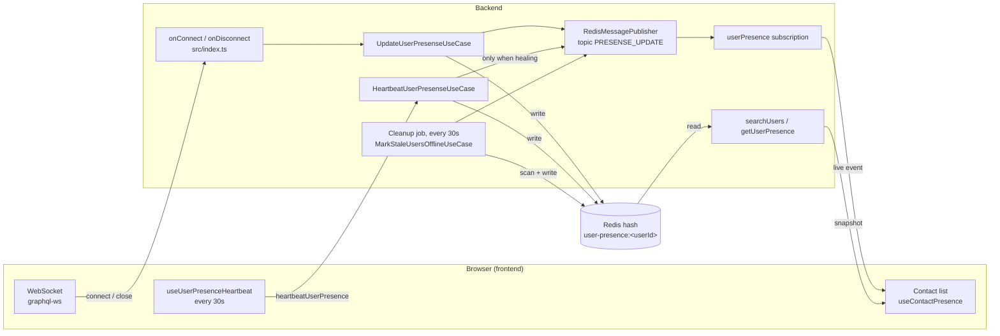
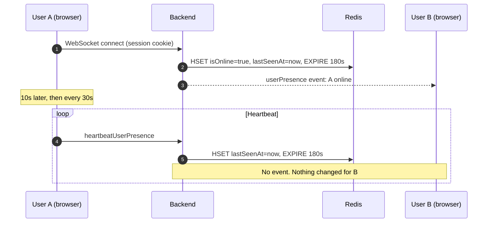
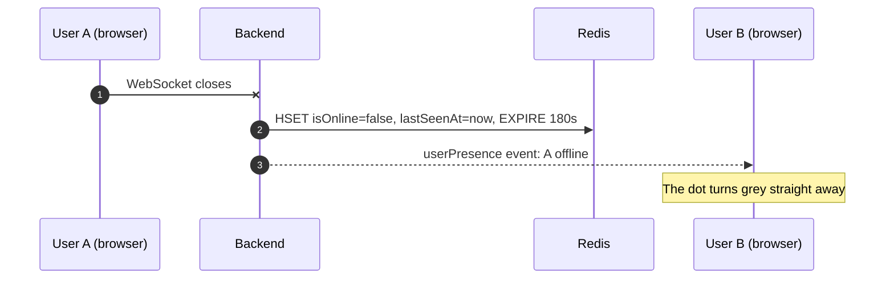
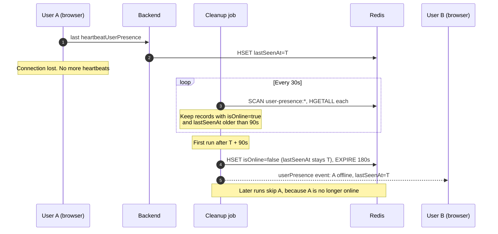
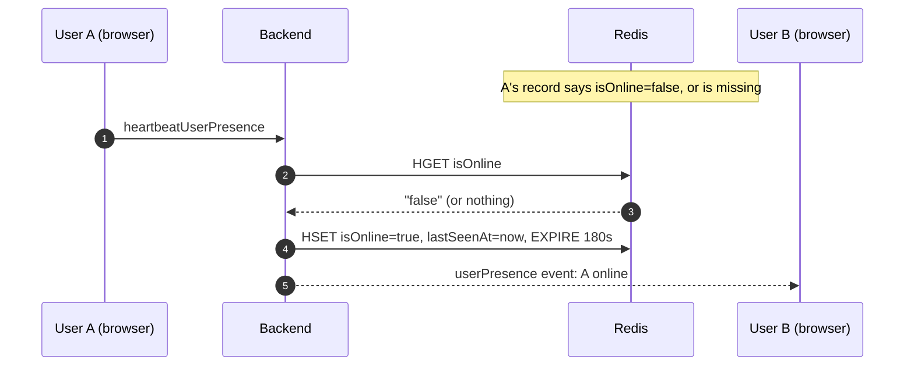
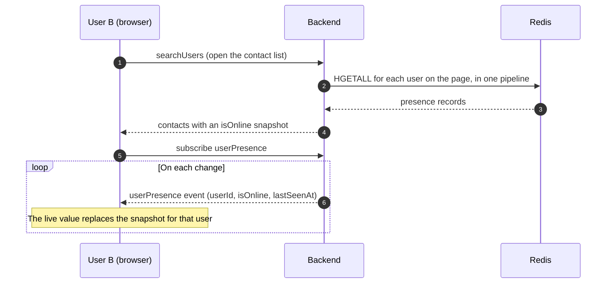
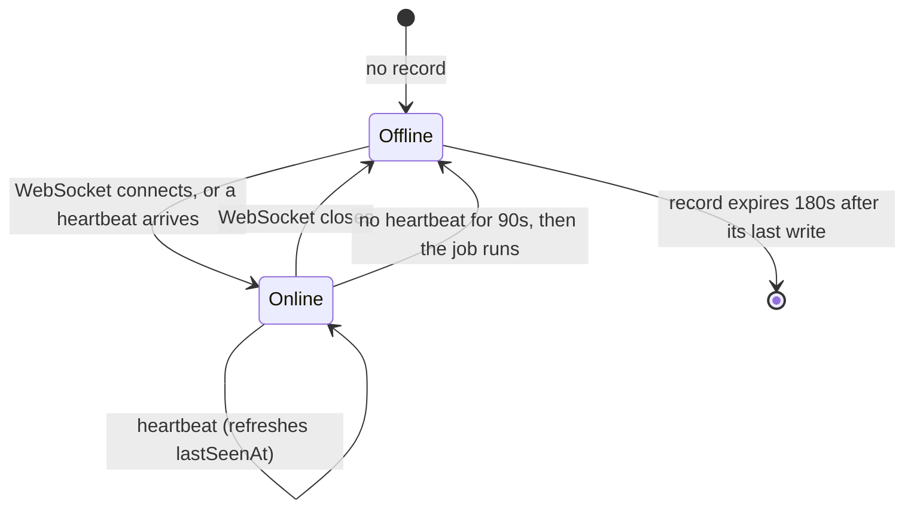

# Presence tracking

How the app knows who is online, end to end: from a browser tab, through the API and Redis, to
the green dot another user sees.

## The short version

- Each user has one record in Redis that says whether they are online and when they were last
  seen.
- Opening the app marks the user online. Closing it marks them offline straight away.
- While the app is open it sends a **heartbeat** every 30 seconds.
- If the heartbeats stop without a clean close (network loss, crash, sleep), a **cleanup job**
  marks the user offline. This takes at most 120 seconds.
- Every change is pushed live to other users through the `userPresence` subscription.

## The pieces



| Piece | Where | What it does |
|---|---|---|
| Presence record | Redis hash `user-presence:<userId>` | Fields `userId`, `isOnline` (`"true"` or `"false"`), `lastSeenAt` (ISO time). Expires 180s after its last write |
| Connect and disconnect handlers | `src/index.ts` (`onConnect`, `onDisconnect`) | Mark the user online when their WebSocket connects, and offline when it closes |
| `UpdateUserPresenseUseCase` | `src/application/usecases/user/update-user-presense/` | Writes `isOnline` and `lastSeenAt`, then publishes the change. Used by the handlers above and the `updateUserPresence` mutation |
| `HeartbeatUserPresenseUseCase` | `src/application/usecases/user/heartbeat-user-presense/` | Refreshes `lastSeenAt` and the record's lifetime. Puts the user back online if the record is missing or says offline |
| Cleanup job | `src/infrastructure/persistence/scheduler/cleanUpPresenceUserScheduler.ts` | Runs `MarkStaleUsersOfflineUseCase` every 30s |
| `MarkStaleUsersOfflineUseCase` | `src/application/usecases/user/mark-stale-users-offline/` | Marks online users with no heartbeat for 90s offline, and publishes one offline event each |
| `UserPresenceRedisRepository` | `src/infrastructure/persistence/repositories/user/` | Reads presence for a list of users, finds all online users with `SCAN`, and marks a user offline |
| `RedisMessagePublisher` | `src/infrastructure/persistence/websocket/redis-pubsub/` | Publishes presence changes on the `PRESENSE_UPDATE` topic |
| `userPresence` subscription | `src/interfaces/graphql/resolvers/UserResolver.ts` | Delivers each presence change to subscribed clients |
| Frontend heartbeat | `frontend/src/hooks/user/useUserPresenseHeartbeat.ts` | Sends `heartbeatUserPresence` 10s after login, then every 30s. Stops on logout |
| Frontend live status | `frontend/src/hooks/user/useContactPresence.ts` | Overlays live `userPresence` events on the `isOnline` snapshot from `searchUsers` |

Build the Redis key with `userPresenceKey(userId)` and match keys with
`USER_PRESENCE_KEY_PREFIX` (both in `src/shared/constants/cache.ts`). Don't write the key by hand.

## Timings

The four timings are constants in `src/shared/constants/cache.ts`. The frontend owns the heartbeat
interval (`PRESENCE_HEARTBEAT_INTERVAL_MS` in `frontend/src/constants/common.ts`); the backend
keeps a copy so the relationship is written down in one place.

| Constant | Value | Meaning |
|---|---|---|
| `PRESENCE_HEARTBEAT_INTERVAL_SECONDS` | 30 | How often the client sends a heartbeat |
| `PRESENCE_OFFLINE_THRESHOLD_SECONDS` | 90 | No heartbeat for this long means offline |
| `PRESENCE_CLEANUP_INTERVAL_SECONDS` | 30 | How often the cleanup job runs |
| `PRESENCE_TTL_SECONDS` | 180 | Lifetime of a presence record after its last write |

They must keep this relationship, and `src/shared/constants/cache.test.ts` fails if they don't:

```
heartbeat interval  <  offline threshold
offline threshold + cleanup interval  <  record lifetime
```

- The first rule keeps an active user online. With 30s and 90s, two heartbeats can be lost, or
  one can be delayed by a throttled background tab, before the user counts as stale.
- The second rule makes sure the job sees a stale record before Redis deletes it. Otherwise the
  record would just vanish and nobody would get an offline event.

One user whose last heartbeat was at 0s:

```
0s            30s           60s           90s           120s                    up to 300s
|-------------|-------------|-------------|-------------|--------------------------|
last          missed        missed        offline       latest possible            record
heartbeat     heartbeat     heartbeat     threshold     offline event              expires

|<------- online, not yet stale -------->|<- stale, -->|<-- offline, kept in Redis -->|
                                           waiting for
                                           the next job run
```

The worst case for an unclean exit is **threshold + cleanup interval = 120 seconds**. The offline
record stays in Redis for another 180s after the job touches it, then expires. A missing record
reads as offline, so nothing changes for other users when it does.

## Flows

### 1. A user opens the app



### 2. A user closes the tab (clean exit)



### 3. A user disappears (unclean exit)

The network drops, the laptop sleeps or the browser crashes. The server sees no close, so the
disconnect handler never runs. The heartbeats stopping is the only signal.



The offline event carries `T`, the last heartbeat, so "last seen" tells B when A was really last
here and not when the job happened to run.

### 4. Self-heal: a user is marked offline while still here

This happens in three cases:

- A heartbeat arrives late, after the job already marked the user offline.
- A heartbeat lands between the job's read and its write.
- The user has two tabs and closes one. The disconnect handler marks them offline even though
  the other tab is still open.



So a wrong "offline" lasts at most one heartbeat: 30s, or about 60s in a background tab whose
timers the browser slows down.

### 5. How another user sees it



## The states of one user



Every arrow between `Online` and `Offline` publishes one `userPresence` event. The `Online` to
`Online` heartbeat publishes nothing.

## Who writes what

| Writer | `isOnline` | `lastSeenAt` | Publishes an event |
|---|---|---|---|
| WebSocket connect | `true` | now | Yes, online |
| WebSocket close | `false` | now | Yes, offline |
| Heartbeat, user already online | unchanged | now | No |
| Heartbeat, user offline or record missing | `true` | now | Yes, online |
| Cleanup job, stale online user | `false` | unchanged (last heartbeat) | Yes, offline |
| Cleanup job, any other user | not touched | not touched | No |

All of them reset the record's lifetime to 180s.

## Known limits

- **Two tabs.** Closing one tab shows the user offline for up to one heartbeat, until the other
  tab's heartbeat heals it. Counting open connections per user would remove the flicker.
- **A socket alone isn't enough.** A client that keeps its WebSocket open but sends no heartbeats
  is marked offline after 90s. The frontend always heartbeats while logged in.
- **One backend instance.** Every instance would run the cleanup job, so a second one could
  publish the same offline event twice.
- **The job scans the whole keyspace.** `SCAN` also walks session and queue keys. That is fine at
  this size; an index of online users would be the next step if it ever isn't.
- **Lost events aren't retried.** If publishing fails after Redis was updated, subscribers miss
  that change until the user's next one. A fresh `searchUsers` snapshot is always correct.
- **Everyone receives everyone's presence.** The `userPresence` subscription has no recipient
  filter (tracked in issue #91).

## Tests

| What | Where |
|---|---|
| Timing rules | `src/shared/constants/cache.test.ts` |
| Heartbeat and self-heal | `src/application/usecases/user/heartbeat-user-presense/heartbeat-user-presense.impl.test.ts` |
| Stale-user sweep | `src/application/usecases/user/mark-stale-users-offline/mark-stale-users-offline.impl.test.ts` |
| Redis reads, scan and mark offline | `src/infrastructure/persistence/repositories/user/UserPresenceRedisRepository.test.ts` |
| Resolver: session user, subscription shape | `src/interfaces/graphql/resolvers/__tests__/UserResolver/UserResolver.presence.test.ts` |
